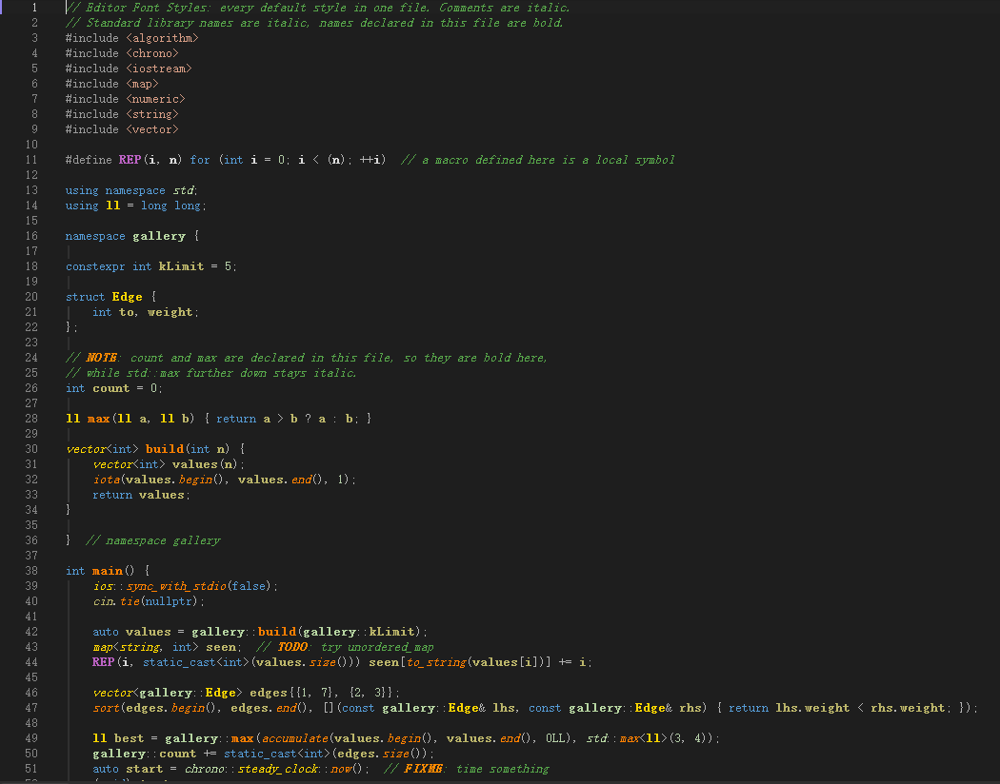

# Visual Studio 编辑器主题

为 Visual Studio 2022 / 2026 的 C++ 编辑器准备的深色配色和编辑器扩展。配色是标准的 `.vssettings` 文件，可以单独导入，也可以配合扩展免导入使用。

| 项目 | 说明 |
| --- | --- |
| **[Visual Assist Dark](visual-assist-dark/README.md)** | 还原 Visual Assist 的深色配色：金色类型、橙色函数、卡其色变量，不需要安装 VA |
| **[VS Code Dark Modern](vscode-dark-modern/README.md)** | 移植 VS Code 默认的 Dark Modern，并附带参考 One Dark Pro、Gruvbox、Monokai 重新设计的鲜艳版 |
| **[Editor Font Styles](editor-font-styles/README.md)** | VSIX 扩展：免导入使用上面的配色，并为代码加上斜体、粗体、标准库符号斜体、本文件符号粗体和括号配对高亮 |



## 快速开始

**只用配色**：在 VS 中打开 **工具 → 导入和导出设置 → 导入选定的环境设置**，选择任一 `.vssettings` 文件，类别勾选 **环境 → 字体和颜色**。

**配合扩展**：安装 [EditorFontStyles.vsix](editor-font-styles/EditorFontStyles.vsix)，在项目根目录放一个 `.editor-font-styles.json`，指定配色和字体：

```jsonc
{
  "colors": "themes/vscode-dark-modern/VSCode-Dark-Modern-Vivid.vssettings",
  "font": { "family": "Consolas", "size": 14 }
}
```

`colors` 的相对路径以配置文件所在目录为起点。配置文件放在 `%USERPROFILE%` 时对所有文件生效。完整选项见 [Editor Font Styles](editor-font-styles/README.md#配置)。
