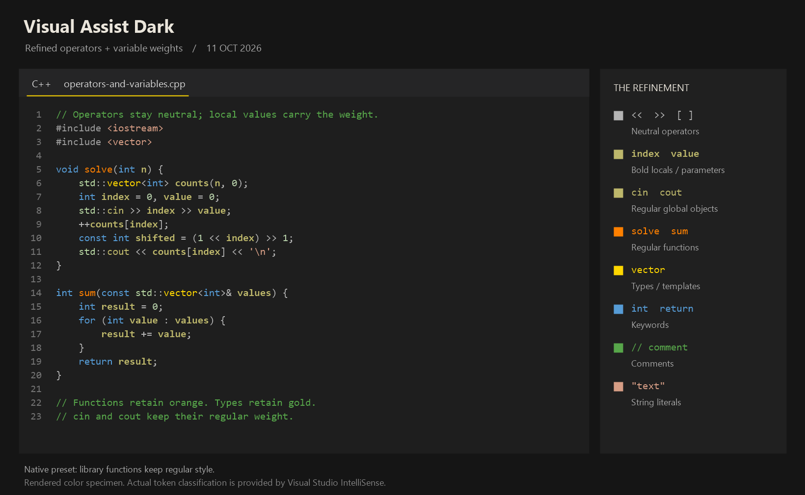

# Visual Assist Dark · Visual Studio 配色复刻

根据本机 Visual Assist 保存的深色配色制作，面向 Visual Studio 2022 / 2026 的 C++ 编辑器。无需购买或安装 Visual Assist，即可使用原生 IntelliSense 的语义着色呈现金色类型、橙色函数、卡其色变量和紫色宏。



预览图是用交付配色绘制的示意图；实际符号分类由 Visual Studio 的 C++ IntelliSense 决定。

## 2026-10-26 括号匹配更醒目

`Brace Matching (Rectangle)` 的填充色从 `#3B3B3B` 改为深青色 `#1F5A5A`。原来的灰色只比背景 `#1E1E1E` 和当前行 `#282828` 亮一点，光标停在括号旁时很难看出哪一对括号被高亮。新颜色与选择背景 `#264F78`（蓝）和引用背景 `#414100`（橄榄）也能区分。两个 `.vssettings` 文件同步修改。

`#3B3B3B` 是本复刻的配套颜色，不是 VA 的值。VA 本机保存的 `Matched Brace/Paren` 是正文色 `#DCDCDC` 加粗、无背景；原生 VS 的括号匹配只能画背景方框，无法复现这种效果。

## 2026-10-15 名称修正

对照 VS 2026（18.10.3）程序集中的格式定义和内置深色主题数据，修正了三个 VS 不识别的项目名称。此前这三项导入后没有生效，颜色值本身不变：

- `control keyword` → `keyword - control`：C# / VB 中 `if`、`return` 等控制关键字现在与其他关键字同为蓝色 `#569CD6`。C++ 的控制关键字使用 `CppControlKeywordSyntacticTokenFormat`，此前已经生效，不受影响。
- `Line Numbers` → `Line Number`：行号现在为 `#858585`，此前保持 VS 默认的 `#8A8A8A`，肉眼几乎看不出差别。
- `Visible White Space` → `Visible Whitespace`：开启“显示空白”后，空格点和制表符箭头现在为灰色 `#858585`，此前为 VS 默认的深青色 `#144852`。

`CurrentLineInactiveFormat` 在 VS 2026 中已没有对应项目，导入时会被忽略，不影响其他颜色。

已导入旧版的用户只需重新导入同名 `.vssettings` 文件，选择“环境 → 字体和颜色”。

## 2026-10-11 优化版

- 把 `CppMemberOperatorSemanticTokenFormat` 从函数橙色改为 `#B4B4B4`。普通、非成员重载和成员重载运算符使用同一灰色，覆盖 `cin >> n`、`cout << ans`、`vector[index]` 等情况。
- 原生版将 **C++ 局部变量和形参**设为卡其色加粗。全局变量、成员字段、类型、宏和函数保持原来的字重；`cin`、`cout` 这类全局对象也保持常规字重。
- VA 兼容版同步修正运算符颜色，符号字重交给 VA 自身判断，见下方“粗体与斜体”。

已导入旧版的用户只需重新导入同名 `.vssettings` 文件，选择“环境 → 字体和颜色”。无需再次切换深色主题。

## 安装

逐页操作见 **[导入和更新指南](INSTALL.md)**，包含文件选择、类别选择、旧版更新、恢复配色和常见情况。

1. 确认 Visual Studio 使用内置的 **深色 / Dark** 主题；已经是深色时跳过这一步。
2. 打开 **工具 → 导入和导出设置 → 导入选定的环境设置**。
3. 按需在向导中保存当前设置；备份是可选的，无需提前单独导出。
4. 浏览并选择本目录的 **`Visual-Assist-Dark.vssettings`**。
5. 导入 **环境 → 字体和颜色**。本文件只包含这个类别。
6. 在 C++ 项目中打开 `semantic-gallery.cpp`，等待 IntelliSense 完成解析，观察效果。

如果仍在使用 Visual Assist 的增强着色，导入 **`Visual-Assist-Dark-with-VA.vssettings`**。它还设置 VA 对应的颜色项目。两个文件任选其一。

安装同仓库的 [Editor Font Styles](../editor-font-styles/README.md) 扩展后可以不导入：仓库根目录的 `.editor-font-styles.json` 已指定原生版，仓库中的文件直接使用本配色，修改主题文件后立即生效。

这是通过 VS 内置导入向导应用的编辑器配色，不需要安装 VSIX 扩展。应用后，主题下拉框仍显示内置深色主题。字体名称、字号、快捷键、窗口布局和项目配置由你已有的设置决定。

## 复刻依据

2026-10-10 从本机 `HKCU\Software\Whole Tomato\Visual Assist X\VaNet17\Format` 和 `VaNet18\Format` 只读提取颜色。两份配置的主要颜色相同。它们是本机保存的 VA 配色实值；未将其声称为所有 VA 版本都相同的出厂默认值。

| 元素 | RGB | VS 中的应用范围 |
| --- | --- | --- |
| 背景 | `#1E1E1E` | 编辑器背景 |
| 类型 | `#FFD700` | 类、结构、类型别名、类模板、泛型类型 |
| 函数 | `#FF8000` | 全局函数、成员函数、静态成员函数、函数模板 |
| 变量 | `#BDB76B` | 局部/全局变量、参数、成员字段、静态字段 |
| 宏 | `#BD63C5` | C++ 预处理宏 |
| 关键字 | `#569CD6` | 普通关键字、控制流关键字 |
| 注释 | `#57A64A` | 普通注释、文档注释 |
| 字符串 | `#D69D85` | 字符串、转义字符、字符串定界符 |
| 数字 | `#B5CEA8` | 数字字面量 |
| 枚举成员 | `#B9771E` | 枚举值 |
| 命名空间 | `#B8D7A3` | 命名空间名称 |
| 运算符 | `#B4B4B4` | 普通运算符、非成员重载、成员重载 |

普通文本使用深色主题的浅灰 `#DCDCDC`；行号、选择背景、当前行和引用背景采用协调的深色辅助颜色。这些辅助项目是本复刻的配套设置，不是声称从 VA 恢复的完整 UI 主题。

映射使用 VS 实际的分类标识符，例如 `CppTypeSemanticTokenFormat`、`CppFunctionSemanticTokenFormat` 和 `CppParameterSemanticTokenFormat`，并覆盖原生编辑器的一般分类。RGB 转换为 `.vssettings` 所需的 `0x00BBGGRR`；例如橙色 `#FF8000` 导出为 `0x000080FF`。

## 粗体与斜体

VA 的 **Local Symbols in Bold** 按定义所在文件判断：当前文件中定义的符号可以加粗。官方还说明它可能按同名符号应用这一效果，并会略微调整粗体符号的颜色。[VA 官方说明](https://www.wholetomato.com/documentation/code-understanding/local-symbols-in-bold)

VA 的 **System Symbols in Italics** 根据系统包含目录等来源识别系统/库符号，并将其显示为斜体；在项目中声明或重写的符号不属于这一组。[VA 官方说明](https://www.wholetomato.com/documentation/code-understanding/system-symbols-in-italics)

原生 `.vssettings` 版使用 VS 已有的分类，实现“局部变量和形参加粗”的近似效果。它不判断符号定义是否在当前文件，也没有复制 VA 对粗体颜色的细微调整。

当前这份配色使用的原生 C++ 函数分类不区分用户函数和系统库函数，因此**系统库函数保持常规字形**。主题文件本身保持纯配色配置。

不使用 VA 时，安装同仓库的 [Editor Font Styles](../editor-font-styles/README.md) 扩展即可获得这两项效果：标准库符号显示为斜体，当前文件中声明的符号显示为粗体，判断规则与 VA 一样按名称进行；它还能给注释等任意项目设置斜体或单独的字体。颜色仍来自本主题。

若仍安装并启用了 VA，可使用兼容版，在 **Visual Assist Options → Coloring and Attributes** 中启用 **Local symbols in Bold** 和 **System symbols in Italics**；其中粗体还要求启用 **Enhanced Syntax Coloring**。不同 VA 版本的页面名称可能略有区别，可按这两个英文选项名查找。

## 效果检查

`semantic-gallery.cpp` 是独立的 C++20 示例，不参与当前工作区的默认构建。可直接在 VS 打开查看。编译运行的预期输出为：

```text
total = 23
Fenwick tree: 46
```

优先检查以下细节：

- `Fenwick`、`Counter`、`Node` 等类型呈金色。
- `add`、`prefix_sum`、`name` 等函数呈橙色。
- 原生版的函数参数、局部变量呈卡其色加粗；`tree_` 等成员字段保持卡其色常规字重。
- 在 `operator_color_demo()` 中，流的 `<<`、`>>`、容器的 `[]` 和内置移位、数组下标都应为灰色。
- `VA_TRACE` 呈紫色，`State::complete` 中的枚举成员呈棕金色。
- 字符串为柔和的鲑色，数字为淡绿色，注释为绿色。

如果变量和函数仍然全是灰色，在 **选项** 中查找 C/C++ 的增强颜色（Enhanced Colorization）和 IntelliSense 设置，并检查文件是否属于已加载的 C++ 项目。关闭 VA 后，以前为了 VA 而禁用的原生 IntelliSense 也需要重新启用。

如果切换主题后颜色被覆盖，选择内置深色主题，再重新导入本配色。恢复时使用向导保存的设置；“字体和颜色 → 使用默认值”也可重置颜色，但会一起重置该类别的其他自定义项。

## 保真范围与验证

核心语法颜色与本机 VA 值逐项匹配。主题文件包含 70 个原生项目，兼容版包含 81 个项目。已验证 XML 结构、无重复项目、RGB/COLORREF 转换和不设置字体/字号，并已编译运行示例。

2026-10-15 起，原生项目名称均已对照 VS 2026 核对，除 `CurrentLineInactiveFormat` 外都能识别；兼容版中以 `VA ` 开头的 11 个项目需要安装 VA 才能核对。

原生版现在包含局部变量和形参的分类加粗，但主题文件本身仍不能实现 VA 按定义文件判断的动态字重、按系统库来源判断的斜体或其专属工具窗口行为；前两项可由 [Editor Font Styles](../editor-font-styles/README.md) 扩展补上。VS 与 VA 对未解析符号、依赖类型、构造函数等的分类可能不同；这些情况需要语言服务支持，单纯主题文件无法完全等同。

用户已导入初版并反馈了实际 C++ 着色截图；本次优化文件尚未自动导入正在使用的 VS，新增效果仍需重新导入后核对。

参考：[Visual Assist 增强语法着色](https://www.wholetomato.com/en/documentation/code-understanding/enhanced-syntax-coloring)、[Visual Studio 字体与颜色设置](https://learn.microsoft.com/en-us/visualstudio/ide/how-to-change-fonts-and-colors-in-visual-studio)。
