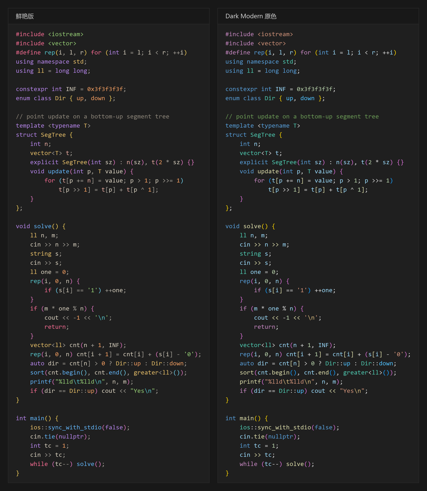

# VS Code Dark Modern for Visual Studio

把 VS Code 的默认主题 Dark Modern 移植到 Visual Studio 2022 / 2026 的 C++ 编辑器，并附带一套参考 One Dark Pro、Gruvbox、Monokai 重新设计的鲜艳版。



<sub>左：鲜艳版；右：Dark Modern 原色。按 VS 的着色规则绘制的示意图。</sub>

## 特点

- **来自 VS Code 源文件**：颜色取自 VS Code 内置的 `dark_modern.json` → `dark_plus.json` → `dark_vs.json` 继承链，C++ token 的对应关系取自 C/C++ 扩展的 `semanticTokenScopes`。
- **对照截图校准**：与 VS Code 同屏截图逐 token 比较像素，彩色括号的层级顺序、重载运算符的颜色都与 VS Code 一致。
- **覆盖完整的编辑器界面**：除语法颜色外，还包括选区、当前行、行号、光标、彩色括号、括号匹配、引用高亮、查找结果、内联提示等 97 个项目。
- **鲜艳版**：各类 token 分到不同色相，变量用暖白色，关键字、函数、类型更醒目。
- **显示器色彩管理**：VS Code 会按显示器的 ICC 配置文件转换颜色，VS 不会；`generate.py` 可以为你的显示器生成观感一致的版本。
- **可重新生成**：所有文件由 [generate.py](generate.py) 生成，可以调整彩度、修改单个颜色或换显示器配置。

## 选择文件

| 文件 | 说明 |
| --- | --- |
| [VSCode-Dark-Modern-Vivid.vssettings](VSCode-Dark-Modern-Vivid.vssettings) | 鲜艳版（推荐），不追求与 VS Code 一致 |
| [VSCode-Dark-Modern-VX2762.vssettings](VSCode-Dark-Modern-VX2762.vssettings) | Dark Modern 原色，按 ViewSonic VX2762-2K 显示器的 ICC 配置文件转换 |

两个文件的项目相同，只是颜色不同，导入其中一个即可。使用其他显示器时，按[生成与自定义](#生成与自定义)生成自己的版本。

## 安装

1. 确认 Visual Studio 使用内置的 **深色 / Dark** 主题。
2. 打开 **工具 → 导入和导出设置 → 导入选定的环境设置**。
3. 选择上表中的文件，类别勾选 **环境 → 字体和颜色**，点击 **完成**。
4. **开启括号对着色**：**工具 → 选项 → 文本编辑器 → 常规 → 显示 → 启用大括号对着色**（Enable brace pair colorization）。VS Code 默认开启，VS 需要手动开启，否则所有括号都是灰色。
5. 打开 C++ 项目中的文件，等待 IntelliSense 解析完成。

导入向导的逐页说明见 [Visual Assist Dark 导入指南](../visual-assist-dark/INSTALL.md)，把文件换成本目录的文件即可。

**使用 [Editor Font Styles](../editor-font-styles/README.md) 扩展时无需导入**：在仓库根目录的 `.editor-font-styles.json` 中写入

```jsonc
"colors": "themes/vscode-dark-modern/VSCode-Dark-Modern-Vivid.vssettings",
"font": { "family": "Consolas", "size": 14 }
```

即可直接使用本配色和字体，重新生成主题文件后立即生效。

> VS 2026 导入只含颜色的设置文件时，会把编辑器字体重置为默认值，导入后需要重新选择字体。使用扩展时没有这个问题。

### 字体与行距

VS 的字号单位是磅，VS Code 是像素，VS 中的磅数约为 VS Code 像素值的 3/4。例如 VS Code 中 18px 的 Consolas，在 VS 中选 **14 磅**最接近；**行距**保持默认的 **1.0**，调大会比 VS Code 更稀疏。

## 鲜艳版

背景、选区、行号、查找和引用高亮等界面颜色与 Dark Modern 相同，只重新设计了语法颜色：

- **各类 token 色相分明**：沿用 One Dark Pro 的分工，关键字紫、函数蓝、类型黄、字符串绿、数字橙；控制流和预处理指令用 Monokai 的粉红，宏和转义字符用青色，成员字段用浅鲑红。
- **变量用暖白色**：变量和参数是代码中最多的 token，使用 Gruvbox 式的暖白色而不是彩色，画面更安静，其他颜色更醒目。
- **运算符保持中性**：`cin >>`、`cout <<`、`cnt[i]` 等重载运算符与 `+`、`=` 一样是暖灰色。
- **亮度和彩度统一**：按 OKLCH 衡量，彩色的亮度在 0.70～0.82、彩度在 0.075～0.17 之间；所有颜色与背景的对比度不低于 4.5:1。

| 元素 | 颜色 | 参考 |
| --- | --- | --- |
| 变量、参数、普通文本 | `#D8D0BF` | Gruvbox 前景色 |
| 运算符、标点 | `#A29E96` | — |
| 关键字（`int`、`const`、`class`、`static_cast`） | `#B484E8` | One Dark Pro 紫 |
| 控制流、预处理指令、`new` / `delete` | `#F26A90` | Monokai 粉红 |
| 类型、命名空间、属性 | `#E6BE68` | One Dark Pro / Gruvbox 黄 |
| 函数 | `#61B2F4` | One Dark Pro 蓝 |
| 成员字段 | `#EAACA1` | One Dark Pro 红，降低彩度 |
| 宏、转义字符 | `#56C4CA` | One Dark Pro 青 |
| 数字、枚举成员 | `#EE9B5F` | One Dark Pro 橙 |
| 字符串 | `#93CA73` | One Dark Pro 绿 |
| 注释 | `#8C8579` | Gruvbox 灰 |
| 彩色括号 1 / 2 / 3 层 | `#F2CE59` / `#E176C1` / `#6CCDEA` | VS Code 的金 → 紫 → 蓝 |

## Dark Modern 原色

<details>
<summary>语法颜色对照表</summary>

| 元素 | 颜色 | VS Code 来源 | VS 颜色项目 |
| --- | --- | --- | --- |
| 编辑器背景 | `#1F1F1F` | `editor.background` | TextView Background |
| 普通文本、标点 | `#CCCCCC` | `editor.foreground` | Plain Text、punctuation |
| 运算符 | `#D4D4D4` | `keyword.operator` | Operator |
| 关键字 | `#569CD6` | `keyword`、`storage.type`、`storage.modifier` | Keyword |
| 控制流关键字 | `#C586C0` | `keyword.control` | CppControlKeyword、keyword - control |
| 预处理指令 | `#C586C0` | `keyword.control.directive` | Preprocessor Keyword |
| `new` / `delete` | `#C586C0` | 语义 `newOperator` | CppNewDelete |
| 类型、类模板 | `#4EC9B0` | `entity.name.type` | CppType、CppRefType、CppValueType、CppClassTemplate |
| 命名空间 | `#4EC9B0` | `entity.name.namespace` | CppNamespace |
| 属性 `[[nodiscard]]` | `#4EC9B0` | `entity.other.attribute` | CppAttributes |
| 函数 | `#DCDCAA` | `entity.name.function` | CppFunction、CppMemberFunction、CppFunctionTemplate |
| 重载运算符 | `#DCDCAA` | `entity.name.function.operator` | CppOperator、CppMemberOperator |
| 变量、参数、成员字段 | `#9CDCFE` | `variable`、`variable.parameter`、`variable.other.property` | CppLocalVariable、CppParameter、CppMemberField、Identifier |
| 枚举成员 | `#4FC1FF` | `variable.other.enummember` | CppEnum |
| 宏 | `#569CD6` | `entity.name.function.preprocessor` | CppMacro |
| 注释 | `#6A9955` | `comment` | Comment |
| 字符串 | `#CE9178` | `string` | String |
| 转义字符 | `#D7BA7D` | `constant.character.escape` | C++ 字符串转义字符 |
| 数字 | `#B5CEA8` | `constant.numeric` | Number、CppUDLNumber |
| 标签 | `#C8C8C8` | `entity.name.label` | CppLabel |

</details>

<details>
<summary>编辑器界面颜色对照表</summary>

| 元素 | 颜色 | VS Code 来源 | VS 颜色项目 |
| --- | --- | --- | --- |
| 行号 | `#6E7681` | `editorLineNumber.foreground` | Line Number |
| 当前行号 | `#CCCCCC` | `editorLineNumber.activeForeground` | Selected Line Number |
| 选区 | `#264F78` | `editor.selectionBackground` | Selected Text |
| 非活动选区 | `#3A3D41` | `editor.inactiveSelectionBackground` | Inactive Selected Text |
| 当前行 | 边框 `#282828` | `editor.lineHighlightBorder` | CurrentLineActiveFormat |
| 光标 | `#AEAFAD` | `editorCursor.foreground` | Caret (Primary) |
| 彩色括号 1 / 2 / 3 层 | `#FFD700` / `#DA70D6` / `#179FFF` | `editorBracketHighlight.foreground1`–`3` | brace pair level one / three / two |
| 不匹配的括号 | `#D21515` | `editorBracketHighlight.unexpectedBracket.foreground` | mismatched brace |
| 括号匹配 | 边框 `#888888`，填充 `#1C261C` | `editorBracketMatch.border` / `.background` | Brace Matching (Rectangle) |
| 引用高亮 | `#474747` | `editor.wordHighlightBackground` | HighlightedReference、HighlightedDefinition |
| 写入引用高亮 | `#093D5B` | `editor.wordHighlightStrongBackground` | HighlightedWrittenReference |
| 其他查找结果 | `#633315` | `editor.findMatchHighlightBackground` | FindHighlight |
| 可见空白 | `#3F3F3E` | `editorWhitespace.foreground` | Visible Whitespace |
| 非活动代码 | `#7E7E7E` | `C_Cpp.inactiveRegionOpacity` 0.55 | Excluded Code |
| 内联提示 | 前景 `#969696`，背景 `#262626` | `editorInlayHint.*` | CppInlineHintsFormat |

</details>

移植时的几处换算：

- **透明度**：VS 的颜色不支持透明度，VS Code 中带透明度的颜色按 `#1F1F1F` 背景预先混合。
- **选区**：VS 以约 40% 的不透明度绘制选区，文件中填的是更亮的颜色，叠加后才等于表中的值。
- **彩色括号**：VS 的第 2 层使用 `brace pair level three`、第 3 层使用 `level two`，所以这两项颜色互换，显示顺序才与 VS Code 一致。

## 生成与自定义

```text
python generate.py                                    # 重新生成目录中的两个文件
python generate.py --palette vivid --chroma 1.15 -o VSCode-Dark-Modern-Vivid.vssettings
python generate.py --palette dark-modern -o VSCode-Dark-Modern.vssettings
python generate.py --profile <ICC 配置文件> -o VSCode-Dark-Modern-<显示器>.vssettings
```

- `--chroma`：把语法颜色的彩度乘以一个倍数，保持亮度和色相，例如 1.15 更艳、0.85 更淡。
- `--palette`：`vivid` 为鲜艳版，`dark-modern` 为 VS Code 原色。
- `--profile`：按显示器的 ICC 配置文件转换颜色，与 VS Code（Chromium）的做法相同，让 VS 与 VS Code 在这台显示器上显示一致。不加 `--palette` 时使用 Dark Modern 原色。显示器正在使用的配置文件可以在 Windows 的“颜色管理”中查看，通常位于 `C:\Windows\System32\spool\drivers\color`。

单个颜色在 `generate.py` 的 `VIVID` 和 `DARK_MODERN` 中修改；不带参数运行时生成的文件和参数记录在 `VARIANTS` 中。修改调色板后，运行 `python render_compare.py` 按新颜色重新绘制对比图（需要 Pillow）。

## 与 VS Code 的差异

以下针对 Dark Modern 原色，鲜艳版本身不追求一致。

- **`using`、`operator` 关键字**：VS Code 显示为紫色；VS 的 C++ 关键字只区分普通关键字和固定的控制关键字，这两个词显示为蓝色。
- **`vector` 的 `[]`**：VS Code 中按括号层级着色；VS 把它识别为重载运算符，显示为函数黄。
- **标点**：`;`、`,`、`.` 在 VS 中归为运算符，显示为 `#D4D4D4` 而不是 `#CCCCCC`。
- **IntelliSense 完成前**：VS 在语义结果到达前把所有标识符显示为变量色，解析完成后与 VS Code 一致。
- **当前查找结果**：VS 把当前匹配显示为选区，没有单独的颜色。
- **非活动代码**：在 C/C++ 选项中开启“对非活动代码块使用不透明度”并设为 55%，效果与 VS Code 相同。
- **IDE 外观**：侧边栏、标题栏、标签页属于整体主题，`.vssettings` 无法设置；本主题只覆盖编辑器。

## 效果预览

打开 [semantic-gallery.cpp](semantic-gallery.cpp)（独立的 C++20 示例，可直接编译运行），对照上面的颜色表检查。变量和函数都是同一种颜色时，确认文件属于已加载的 C++ 项目，并且 C/C++ IntelliSense 已启用。

## 参考

- [VS Code 主题颜色参考](https://code.visualstudio.com/api/references/theme-color)
- [Visual Studio：更改字体和颜色](https://learn.microsoft.com/en-us/visualstudio/ide/how-to-change-fonts-and-colors-in-visual-studio)
